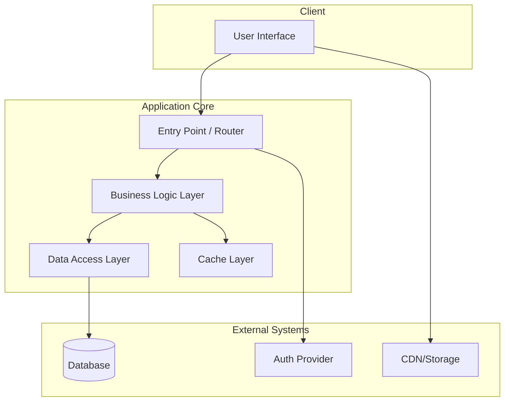
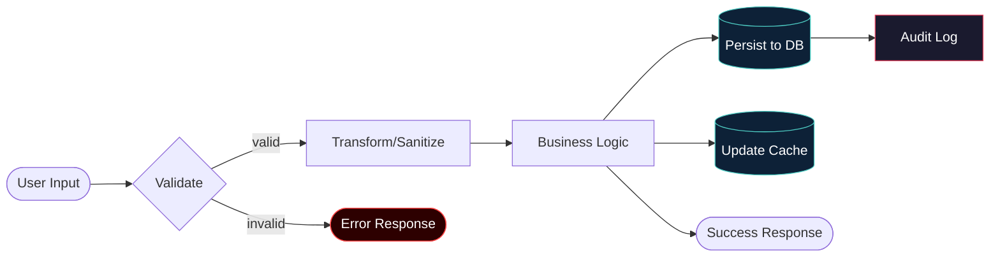
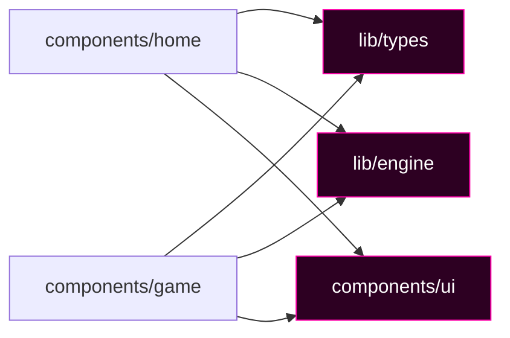
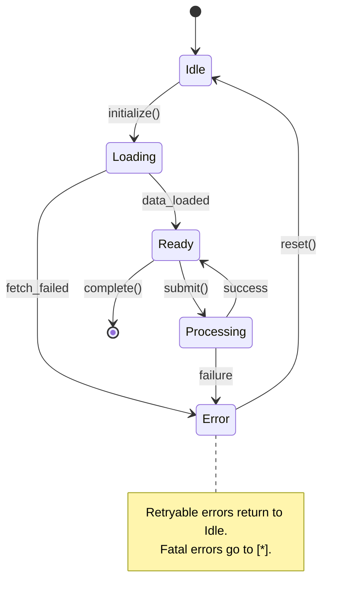
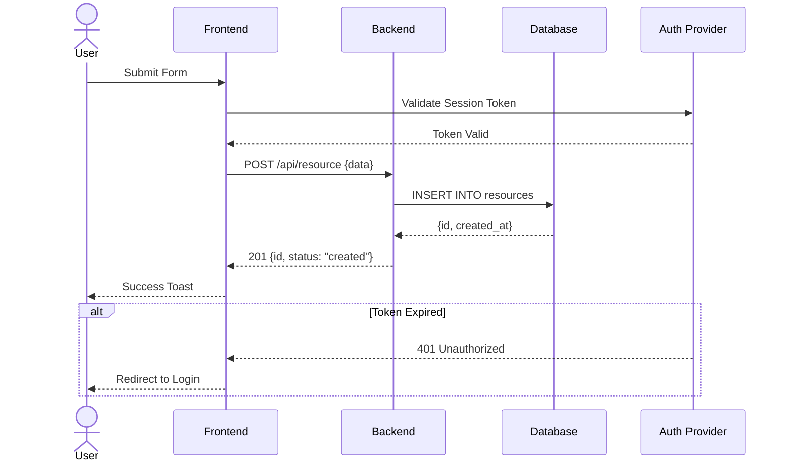

# Graphify — Living Architecture Visualization Engine

> **MANDATORY PROTOCOL**: This skill is not optional on large-scale projects. If the
> current project has **10+ source files**, **3+ distinct subsystems**, or the task
> involves a **multi-file implementation plan**, you MUST invoke Graphify at session
> start and after any significant architectural change.

## Overview

Graphify transforms codebases into living, structured visual documentation using
Mermaid diagrams. It operates across five diagram dimensions to give agents and
humans a complete mental model of the system before touching code.

**Core Philosophy:** A diagram caught before coding saves 10x the tokens of a
diagram made after a bug. Visualize first, implement second.

---

## Trigger Conditions (Non-Negotiable)

Invoke Graphify automatically when ANY of the following are true:

| Condition | Threshold |
|-----------|-----------|
| Project source files | ≥ 10 files |
| Distinct subsystems | ≥ 3 systems |
| Implementation plan scope | ≥ 3 components changed |
| User explicitly asks to "understand", "map", "architect" | Always |
| Post-refactor verification | After any structural change |

---

## Five Diagram Dimensions

Graphify produces diagrams across five mandatory dimensions. Each dimension has a
specific Mermaid type and a structured generation protocol.

---

### Dimension 1: System Topology (C4 Architecture)

**When:** Always. This is the master map. Generate first.

**Mermaid Type:** `C4Context` or `graph TD`

**Protocol:**
1. Scan `package.json`, `pyproject.toml`, `Cargo.toml`, `go.mod`, or equivalent
   to identify all top-level modules.
2. Identify all external services (APIs, databases, auth providers, CDNs).
3. Map user-facing entry points (pages, routes, CLI commands).
4. Generate a top-down hierarchical graph showing all subsystems and their
   boundaries.

**Template:**


**Enforcement Rules:**
- Every subsystem must appear as a node. No hidden systems.
- External services must be clearly differentiated (use `[(Database)]` notation).
- Direction: always TD (top-down) for topology.

---

### Dimension 2: Data Flow Diagram

**When:** Before implementing any feature that touches data persistence, API
boundaries, or state mutations.

**Mermaid Type:** `flowchart LR`

**Protocol:**
1. Identify all data sources (user input, external APIs, databases, files).
2. Trace data through each transformation layer (validation, processing, storage).
3. Identify all data sinks (responses, storage, logs, cache).
4. Mark all async boundaries with `:::async` class.
5. Mark all error paths with `:::error` class.

**Template:**


---

### Dimension 3: Component Dependency Graph

**When:** Before any refactor. After adding new components/modules.

**Mermaid Type:** `graph LR`

**Protocol:**
1. Scan all import/require/use statements in source files.
2. Build an adjacency list: `file → [imported_from]`.
3. Identify circular dependencies (mark red).
4. Identify orphan components (no importers) — potential dead code.
5. Identify hub nodes (imported by 5+ files) — critical path risk.

**Template:**


**Enforcement Rules:**
- Circular dependencies MUST be flagged with `stroke:#ff0000,stroke-width:3px`.
- Hub nodes (≥5 dependents) MUST be flagged with distinct styling.
- Output a written list of: `Circular deps: []`, `Hub nodes: []`, `Orphans: []`

---

### Dimension 4: State Machine Diagram

**When:** Before implementing any stateful component, finite automaton, game engine,
auth flow, or multi-step wizard.

**Mermaid Type:** `stateDiagram-v2`

**Protocol:**
1. Identify all distinct states (enum values, phase strings, status flags).
2. Identify all transitions (actions, events, timer callbacks).
3. Identify terminal states (complete, error, cancelled).
4. Identify guard conditions on transitions.

**Template:**


---

### Dimension 5: Sequence / API Flow Diagram

**When:** Before implementing multi-actor flows — auth flows, API chains, webhooks,
user journeys, background jobs.

**Mermaid Type:** `sequenceDiagram`

**Protocol:**
1. Identify all actors (user, frontend, backend, external services, databases).
2. Trace the happy path first, annotated with HTTP verbs and data shapes.
3. Trace error paths as `alt` blocks.
4. Mark async operations with `par` blocks.

**Template:**


---

## Execution Protocol

### Phase 0 — Orientation (Always First)

Before generating any diagrams:

1. **Scan the project structure** using `list_dir` on the root and key subdirectories.
2. **Read the manifest file** (`package.json`, `Cargo.toml`, `pyproject.toml`, etc.)
3. **Read the AGENTS.md or README** if present for architectural context.
4. **Identify the scale** — count source files, subsystems, external dependencies.

> If scale < 10 files and < 3 subsystems: skip Graphify, proceed normally.
> If scale ≥ threshold: proceed with all five dimensions.

### Phase 1 — Generate (Mandatory Dimensions First)

For large-scale projects, always generate in this order:

1. Dimension 1: System Topology (always)
2. Dimension 3: Component Dependency Graph (always)
3. Dimension 4: State Machine (if stateful components present)
4. Dimension 2: Data Flow (if data mutations present)
5. Dimension 5: Sequence (if multi-actor flows present)

### Phase 2 — Document

Write all generated diagrams to a `docs/architecture/` directory in the project:

```
docs/architecture/
  system-topology.md       ← Dimension 1
  data-flow.md             ← Dimension 2
  dependency-graph.md      ← Dimension 3
  state-machines.md        ← Dimension 4
  sequence-flows.md        ← Dimension 5
  graphify-index.md        ← Master index linking all diagrams
```

Each file follows this template:
```markdown
# [Diagram Name]

> Generated by Graphify on [DATE]. Last updated: [DATE].

## Diagram

\```mermaid
[DIAGRAM]
\```

## Analysis Notes

- **Critical paths:** [list]
- **Risk areas:** [list]
- **Stale/dead code suspects:** [list]
```

### Phase 3 — Gate (Implementation Block)

After generating diagrams, output a **Graphify Gate Report** before proceeding:

```
GRAPHIFY GATE REPORT
====================
✓ System Topology:       Generated (N nodes, M edges)
✓ Dependency Graph:      Generated (N circular deps, M hub nodes, K orphans)
✓ State Machines:        Generated (N states, M transitions)
✓ Data Flow:             Generated (N sources, M sinks)
✓ Sequence Flows:        Generated (N actors, M steps)

⚠ RISK AREAS IDENTIFIED:
  - [List any circular deps, high-risk hub nodes, missing error paths]

🔒 CLEARED TO IMPLEMENT: [YES/NO]
   Reason if NO: [explain blocking risk]
```

If `CLEARED TO IMPLEMENT: NO` — surface the risk to the user and wait for
acknowledgment before proceeding.

---

## Anti-Patterns (NEVER Do These)

1. **Never skip Phase 0** — generating diagrams without reading the codebase
   produces phantom architectures.
2. **Never use placeholder nodes** — every node in a diagram must correspond to a
   real file, module, or service.
3. **Never skip the Gate Report** — the report is the handoff document between
   visualization and implementation.
4. **Never generate only one dimension** — a system topology without dependency
   analysis gives false confidence.
5. **Never use Mermaid with `securityLevel` other than `strict`** — per AGENTS.md
   constraint 12.

---

## Integration with Other Skills

- **Before using `next-best-practices`**: Run Dimension 1 + 3 first.
- **Before using `clerk-setup`**: Run Dimension 5 (auth sequence flow) first.
- **Before using `deploy-to-vercel`**: Run Dimension 1 to verify all external
  service connections are mapped.
- **After using `self-annealing`**: Regenerate Dimension 3 to sync dependency graph.

---

## Common Mistakes

1. **Over-collapsing nodes**: Resist the urge to merge subsystems for "simplicity."
   Show the real structure, not the ideal one.
2. **Missing async boundaries**: Every `setTimeout`, `setInterval`, async API call,
   or background job must appear in Data Flow or Sequence diagrams.
3. **Forgetting external services**: Auth providers, CDNs, analytics, and logging
   services are real architectural nodes — include them.
