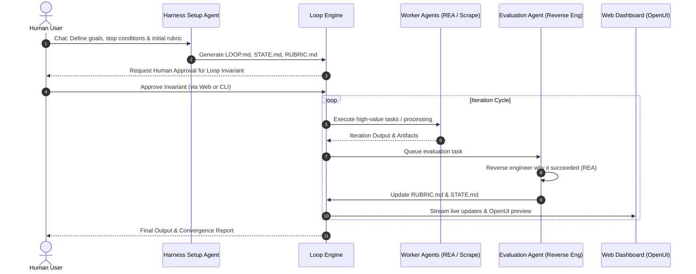

# Loop Engineering: Patterns and Starters

## Overview
Based on patterns pioneered by Addy Osmani and Boris Cherny, `loop-engineering` formalizes AI agent workflows into deterministic, self-correcting loops with formal invariants, budget ceilings, convergence criteria, and human-in-the-loop checkpoints.

## Core Concepts

### 1. Loop Invariant
A formal condition that **must remain true** across all iterations of the loop:
- Invariant definition is agreed upon with the human user during Phase 1.
- In Phase 2, the human explicitly approves or modifies the invariant.
- If an iteration threatens or violates the invariant, the harness halts and triggers human review.

### 2. Stop Conditions
Clear, non-ambiguous termination boundaries:
- **Success Condition**: Output meets or exceeds the convergence threshold in `RUBRIC.md` (e.g., score >= 0.95 across all dimensions).
- **Iteration Ceiling**: Maximum allowable loops (e.g., `max_iterations: 10`).
- **Cost / Token Budget**: Maximum cumulative budget (e.g., `$5.00` or `500,000 tokens`).
- **Stagnation Trap**: Halt if score delta remains < 0.02 for 3 consecutive iterations.

### 3. Iteration Rubric Evolution
The evaluation rubric (`RUBRIC.md`) is not static:
- Starts with baseline criteria agreed with the user in Phase 1.
- After each successful iteration, the **Evaluation Agent** and **REA Reverse Engineering Agent** uncover why the solution succeeded.
- New quality gates and refined weights are added to the rubric dynamically.

## User Flow Integration



## CLI Commands
```bash
# Initialize loop definition
python 02-loop-engineering/loop_manager.py init

# Run loop with invariant enforcement
python 02-loop-engineering/loop_manager.py run

# Check loop audit and state
python 02-loop-engineering/loop_manager.py status
```
