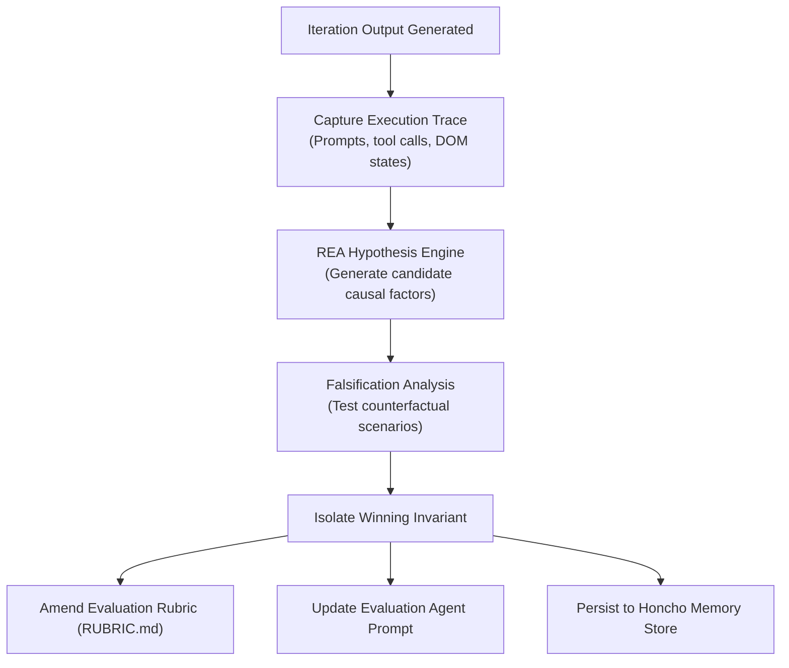

# Reverse Engineering Methodology in Agent Loops

## 1. Why Reverse Engineer Success?
In traditional agent loops, when an iteration "passes", the system terminates without understanding *why* it passed. In complex, non-deterministic agent workflows, passing can easily be caused by:
- Accidental prompt phrasing that happened to fit a narrow test case.
- Random tool call ordering that masked a latent bug.
- Uncontrolled temperature fluctuations.

**The Reverse Engineering Loop philosophy changes this:**
Every successful iteration is treated as an empirical artifact to be reverse engineered. By answering *"Why did this succeed?"*, the harness isolates the true invariant mechanism and bakes it permanently into:
1. `02-loop-engineering/RUBRIC.md` (as a new weighted criterion).
2. The **Evaluation Agent's** system prompt (as an explicit evaluation rule).
3. **Honcho Memory** (as a persistent learning across all future iterations).

---

## 2. The REA Deconstruction Pipeline

### Steps:
1. **Trace Capture**: Capture token usage, memory snapshots, tool invocations, and output diffs.
2. **Hypothesis Formulation**: Propose 2-4 candidate reasons for performance improvement.
3. **Falsification**: Compare against prior iteration failures to verify whether the factor is truly causal or incidental.
4. **Invariant Codification**: Transform the causal factor into a measurable rubric rule.
5. **Memory Commitment**: Save the finding into `storage/<session>_learnings.jsonl`.
