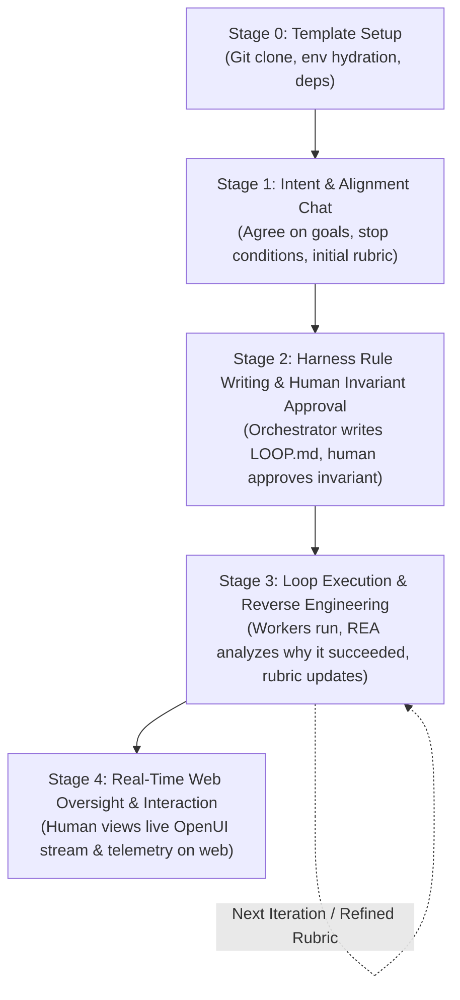

# Reverse Engineering Loop: Complete User Flow

The harness follows a strict 5-stage lifecycle designed for high-value strategic tasks, high-volume processing, and compute-intensive workflows.



---

## Stage 0: User Sets Up Template Project
The user clones the template repository and sets up the environment:
```bash
git clone https://github.com/AhmedNasser-bug/Reverse-engineering-loop.git
cd Reverse-engineering-loop
pip install -r requirements.txt
npm install
cp .env.example .env
```

### Template Directory Mapping:
1. `01-rea/`: Reverse engineering engine ([morluto/rea](https://github.com/morluto/rea)), trace deconstruction, and causal factor extraction.
2. `02-loop-engineering/`: Loop contracts (`LOOP.md`, `STATE.md`, `RUBRIC.md`, `loop_manager.py`) inspired by Addy Osmani and Boris Cherny.
3. `03-orchestration/`: Persistent dialectic memory ([plastic-labs/honcho](https://github.com/plastic-labs/honcho)), packaged skills (RTK, Graphify, web scraping, REA, OpenUI), MCP server configs, and orchestration rules.
4. `04-processing/`: Priority task queues, worker pools, batch processors, and the self-improving Evaluation Agent.
5. `05-dashboards/`: Real-time web server with OpenUI integration ([wandb/openui](https://github.com/wandb/openui)) and live SSE telemetry.

---

## Stage 1: User Chats with Agent to Agree on Goals & Initial Rubric
The user interacts with the harness chat interface or CLI (`python harness.py chat`):
- **User defines**: The high-value objective, data targets, or compute task.
- **Agent and User agree on**:
  - Primary goal statement.
  - Initial evaluation rubric dimensions and convergence threshold.
  - Strict stop conditions (maximum iterations, dollar budget ceiling, stagnation trap).

---

## Stage 2: Harness Writes Rules & Human Approves the Loop Invariant
This is the **first mandatory human contact point** with the active execution loop:
1. The harness compiles the agreed constraints into `02-loop-engineering/LOOP.md` and `02-loop-engineering/RUBRIC.md`.
2. The harness establishes the **Loop Invariant**—a strict boundary condition that can never be violated during execution (e.g. *all claims must cite raw execution traces; zero ungrounded hallucinations*).
3. **Human Approval Gate**: Execution is strictly halted until the human approves or edits the invariant via the Web Dashboard or CLI:
   ```bash
   python 02-loop-engineering/loop_manager.py approve
   ```

---

## Stage 3: Loop Runs, Reverse Engineers Success & Evolves Rubric
Once unlocked by human approval, the loop runs through its iterations:
1. **Worker Agents Execute**: Tasks are pulled from `04-processing/task_queue.py` using web scraping, deep research, and processing tools.
2. **REA Reverse Engineers the Success Factor**: When an iteration output is produced, REA analyzes the execution trace to answer: **"Why exactly did this succeed?"**
   - Did a specific prompt structure prevent errors?
   - Did pre-flight schema enforcement eliminate retries?
   - Did RTK token targeting isolate the crucial context?
3. **Rubric & Evaluation Agent Update**:
   - The discovered causal mechanism is translated into an explicit rubric criterion and appended to `02-loop-engineering/RUBRIC.md`.
   - The Evaluation Agent's prompt is dynamically updated with the new rule.
   - Learnings are permanently saved to Honcho persistent memory.
4. **Task Re-Queueing**: The next iteration's evaluation task is queued against the updated rubric until convergence is reached.

---

## Stage 4: Human Interacts via Web Dashboard in Real Time
The human monitors and directs the loop in real time at `http://127.0.0.1:8080`:
- **Real-Time Convergence Graph**: View iteration scores approaching the >= 0.950 target.
- **Telemetry Cards**: Track live LLM token usage and budget consumption.
- **REA Success Cards**: Read live causal post-mortems explaining why each iteration succeeded.
- **Dynamic Rubric Viewer**: Observe how the evaluation criteria evolve in real time.
- **OpenUI Component Sandbox**: Inspect dynamic generative UI widgets rendered directly from iteration outputs.
